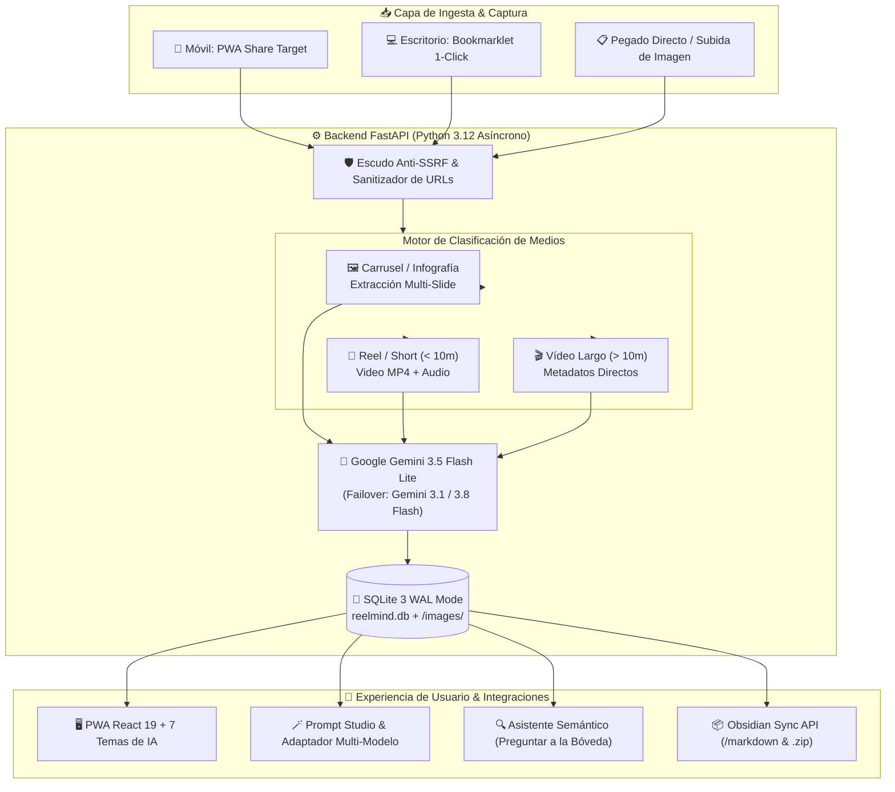

<div align="center">

# 🧠 ReelMind — AI Knowledge Vault & Prompt Studio

**Tu segundo cerebro inteligente para capturar, analizar, optimizar y organizar contenido técnico, prompts y herramientas desde TikTok, Instagram, YouTube, X y la web.**

[](https://fastapi.tiangolo.com)
[](https://react.dev)
[](https://www.typescriptlang.org)
[](https://tailwindcss.com)
[](https://deepmind.google/technologies/gemini/)
[](https://www.sqlite.org)
[](https://www.docker.com)
[](https://unraid.net)
[](https://web.dev/progressive-web-apps/)
[](LICENSE)

<br/>

[🌐 Demo en Producción](https://reels.wacko87.es) • [✨ Características](#-características-destacadas) • [🏗️ Arquitectura](#-arquitectura-del-sistema) • [🚀 Despliegue](#-guía-de-despliegue) • [🔄 Sincronización con Obsidian](#-integración-con-obsidian) • [🛡️ Seguridad](#-seguridad-y-blindaje-homelab) • [📡 API Reference](#-referencia-de-la-api)

</div>

---

## 💡 ¿Por qué ReelMind?

A todos los desarrolladores y creadores nos ocurre a diario: descubrimos un reel o vídeo en **Instagram**, **TikTok**, **YouTube** o **X** con una herramienta de IA innovadora, una arquitectura de agentes, una fórmula de prompts para Midjourney o un script de automatización... lo guardamos en la app de turno y **se pierde para siempre** en un pozo sin fondo.

**ReelMind soluciona esto de raíz convirtiendo vídeos e infografías en conocimiento técnico estructurado y accionable:**

1. **Ingesta con 1 toque:** Comparte desde el menú nativo de tu iPhone/Android (PWA Share Target), usa el bookmarklet de escritorio o pega cualquier enlace directo o captura de pantalla.
2. **Extracción Multimodal con Gemini 3.5 / 3.8 Flash:** Procesa simultáneamente vídeo, audio y texto sobreimpreso en pantalla (OCR) o carruseles completos de hasta 10 diapositivas.
3. **Ficha Técnica Estructurada:** Extrae de forma automática:
   - 🛠️ **Herramientas de IA:** Nombres propios exactos (Claude Code, ElevenLabs, Flux 1.1 Pro, Cursor, n8n...).
   - ⚡ **Prompts literales:** Fórmulas completas con modificadores de renderizado (`--ar`, `--v 6.1`, etc.) listas para copiar.
   - 📋 **Pasos ordenados:** Guía paso a paso para replicar el truco sin tener que volver a ver el vídeo entero.
   - ⏱️ **Tiempo estimado:** Clasificación por dedicación (`< 5 min`, `15-30 min`, `> 1 hora`).
4. **Almacenamiento Local & Obsidian Sync:** Base de datos SQLite privada en tu servidor/NAS con endpoint Markdown nativo y exportación en `.zip` compatible con tu bóveda de Obsidian.

---

## 📱 Compatibilidad de Fuentes

| Plataforma | Tipo de Contenido | Estrategia de Procesamiento |
|---|---|---|
| **Instagram** | Reels (`/reel/`) | Descarga ligera 720p + inferencia multimodal audio/visión |
| **Instagram** | Carruseles & Posts (`/p/`) | Descarga de hasta 10 diapositivas en alta resolución + OCR visual |
| **TikTok** | Vídeos y trucos cortos | Extracción de audio + metadatos + transcripción técnica |
| **YouTube** | Shorts (`/shorts/`) | Análisis multimodal con prompts sobreimpresos en pantalla |
| **YouTube** | Tutoriales y Cursos (`> 10 min`) | **Zero-Download** (análisis de metadatos ultra-rápido en ~500 tokens) |
| **X / Twitter** | Hilos, infografías y vídeos | Ingesta de capturas, cheatsheets y clips técnicos |
| **Web / Imágenes** | Infografías, PNG/JPG, Base64 | OCR minucioso de parámetros, diagramas y tablas comparativas |

---

## 🏗️ Arquitectura del Sistema



---

## ✨ Características Destacadas

### 1. 🖼️ Portadas Inteligentes Procedurales (Smart AI Covers)
Para vídeos sin miniatura óptima o con imágenes saturadas de clickbait, ReelMind genera automáticamente portadas de alto impacto estético clasificadas por **arquetipos visuales**:
- **Código & Desarrollo:** Atmósfera azul cian, marca de agua de consola de terminal y resplandores tecnológicos.
- **Generación Visual & Arte:** Púrpura noche espacial para Midjourney, Flux y Stable Diffusion.
- **Vídeo & Cinemática:** Acentos carmesí profundo para Sora, Kling, Runway y Luma.
- **Agentes & Workflows:** Cobre ardiente y circuitos para n8n, CrewAI, LangChain y Claude Code.
- **Voz & Audio Sintético:** Esmeralda digital para ElevenLabs, Suno y Udio.
- **Razonamiento & LLMs:** Terracota editorial suave y tipografía Newsreader Serif.

*(Puedes alternar en cualquier momento entre la portada inteligente con IA y la miniatura original del vídeo con un solo clic).*

### 2. 📸 Soporte Exhaustivo para Carruseles e Infografías
- Descarga y visualiza todas las diapositivas de un carrusel de Instagram sin recortes (`stp=dst-jpg_e15`).
- Visor tipo galería interactivo con carrusel horizontal e indicador de fotos.
- Gemini Vision analiza la secuencia completa y extrae prompts tanto del contenido escrito como de las diapositivas gráficas.

### 3. 🎨 7 Temas de Diseño Profesional
ReelMind cuenta con una interfaz pulida hasta el último detalle inspirada en los ecosistemas de IA líderes:
- **Claude:** Estética editorial Newsreader, terracota suave y fondos cálidos.
- **Gemini:** Azul espacial cuántico y geometría moderna.
- **ChatGPT:** Carbón minimalista y acento verde esmeralda.
- **OpenClaw:** Negro táctico de alto contraste con acentos carmesí neón.
- **Hermes Agent:** Consola de inteligencia cibernética con tipografía JetBrains Mono.
- **Vercel / v0:** Negro OLED puro y azul cobalto ultrapreciso.
- **Midjourney:** Atmósfera inmersiva espacial con destellos lavanda.

### 4. 🪄 Prompt Studio & Adaptador Multi-Modelo
- **Bóveda Centralizada:** Consulta y copia todos los prompts extraídos de tus fuentes en un solo lugar.
- **Optimizador Multi-Modelo:** Convierte cualquier prompt en bruto a la sintaxis y fortalezas técnicas de **Midjourney v6.1**, **Flux 1.1 Pro**, **DALL-E 3** o **Claude / ChatGPT**.

### 5. 🔍 Asistente Semántico RAG ("Preguntar a la Bóveda")
¿No recuerdas en qué vídeo se explicaba cómo crear un MCP en Claude o qué herramienta de voz clonada era la mejor? Hazle la pregunta a ReelMind en lenguaje natural: Gemini rastrea toda tu biblioteca y te devuelve una síntesis detallada citando las fuentes directas.

---

## 🔄 Integración con Obsidian

ReelMind se integra de forma transparente con **Obsidian** para que todo el conocimiento guardado pase a tu bóveda personal:

### A. Sincronización Automática vía API
ReelMind expone un endpoint nativo de Markdown por cada ficha:
```http
GET /api/reels/{id}/markdown
```

**Ejemplo de nota generada automáticamente:**
```markdown
---
title: "Mapeo y diseño automatizado de redes con Claude Code"
platform: "instagram"
url: "https://instagram.com/reel/..."
author: "Alberto Ramos"
media_type: "reel"
difficulty: "Intermedio"
estimated_time: "15-30 min"
folder: "Homelab"
ai_tools:
  - "Claude Code"
  - "Nmap"
tags:
  - "homelab"
  - "redes"
  - "claude"
---

# Mapeo y diseño automatizado de redes con Claude Code

> [!abstract] Resumen Ejecutivo
> Explicación de cómo utilizar Claude Code junto con herramientas de escaneo para generar diagramas topológicos interactivos de una infraestructura local.

## 🛠️ Herramientas de IA
- `Claude Code`
- `Nmap`

## 📋 Pasos Clave
1. Clonar el repositorio del mapa de red en el entorno local.
2. Ejecutar el script de auditoría con permisos de lectura.
3. Solicitar a Claude Code la estructuración de subredes.

## ⚡ Prompts Detectados
```text
Analiza la salida de este escaneo y genera un diagrama Mermaid con las VLANs detectadas.
```
```

### B. Exportación Completa de la Bóveda en `.zip`
Con un clic en **Exportar Bóveda** (`/api/export/vault`), descargas toda tu colección organizada en carpetas físicas con un archivo `Indice_Boveda.md` con enlaces internos `[[wikilinks]]`.

---

## 🛡️ Seguridad y Blindaje Homelab

ReelMind está desarrollado bajo estándares de seguridad para despliegues autoalojados expuestos a internet:

- **🔐 Autenticación por PIN (`AUTH_PIN`):** Bloqueo total de la interfaz y las APIs mediante token de sesión seguro.
- **🚫 Escudo Anti-SSRF:** Bloqueo estricto de resoluciones hacia IPs locales (`127.0.0.1`, `192.168.x.x`, `10.x.x.x`, `172.16.x.x`, `.local`, `.internal`) con validación estricta por lista blanca de dominios.
- **⏱️ Timeouts Extendidos en Proxy Inverso:** Compatible con Nginx Proxy Manager con directivas de 300 segundos para no cortar inferencias de vídeo densas.
- **🧼 Sanitización XSS:** Todos los enlaces externos e iframes están fuertemente filtrados y restringidos al protocolo `https://`.
- **💾 SQLite en Modo WAL:** Modo Write-Ahead Logging (`journal_mode=WAL`) para máxima concurrencia y cero bloqueos de lectura/escritura.

---

## 🚀 Guía de Despliegue

### Opción 1: Docker Compose (Recomendada)

Crea un archivo `docker-compose.yml`:

```yaml
version: '3.8'

services:
  reelmind:
    image: ghcr.io/wacko87/reelmind:latest
    container_name: reelmind
    restart: unless-stopped
    ports:
      - "8000:8000"
    environment:
      - PORT=8000
      - DATA_DIR=/data
      - GEMINI_API_KEY=tu_gemini_api_key_aqui
      - GEMINI_MODEL=gemini-3.5-flash-lite
      - AUTH_PIN=1234 # Opcional: deja vacío para acceso abierto
    volumes:
      - ./data:/data
```

Inicia el servicio:
```bash
docker compose up -d
```

Accede a la app en `http://localhost:8000`.

---

### Opción 2: Producción en Servidor Unraid & Nginx Proxy Manager

1. **Configuración en Unraid (red bridge o VLAN):**
   - **Contenedor:** `reelmind`
   - **Puerto:** `8000`
   - **Ruta de datos persistente:** `/mnt/cache/appdata/reelmind/data` -> `/data`
   - **Variables de entorno:**
     - `GEMINI_API_KEY`: Tu clave de Google AI Studio.
     - `GEMINI_MODEL`: `gemini-3.5-flash-lite` (o `gemini-3.8-flash`).
     - `AUTH_PIN`: Tu PIN de acceso si deseas restringir la entrada.

2. **Configuración en Nginx Proxy Manager:**
   - **Dominio:** `reels.tudominio.es`
   - **Forward IP / Port:** `IP_DEL_SERVIDOR` / `8000`
   - **SSL:** Let's Encrypt con *Force SSL* y *HTTP/2*.
   - **Configuración Avanzada (Timeout para IA):**
     En la pestaña **Advanced** del Proxy Host, añade:
     ```nginx
     proxy_read_timeout 300s;
     proxy_connect_timeout 300s;
     proxy_send_timeout 300s;
     client_max_body_size 100M;
     ```

---

### Opción 3: Desarrollo Local (Mac / Linux)

```bash
# 1. Clonar el repositorio
git clone https://github.com/Wacko87/reelmind.git
cd reelmind

# 2. Configurar variables
cp .env.example .env
# Añade tu GEMINI_API_KEY en .env

# 3. Iniciar el entorno unificado
./dev.sh
```

- Frontend: `http://localhost:5173`
- Backend API Docs: `http://localhost:8000/docs`

---

## 📡 Referencia de la API

| Método | Endpoint | Descripción |
|---|---|---|
| `POST` | `/api/reels/analyze` | Descarga, analiza con Gemini y almacena un reel, post o imagen. |
| `GET` | `/api/reels` | Listado con búsqueda, filtrado por herramientas, etiquetas y estados. |
| `GET` | `/api/reels/{id}` | Información detallada con prompts, pasos, autor y diapositivas. |
| `PATCH` | `/api/reels/{id}` | Edición de notas, etiquetas, carpetas o estado (`tested`, `favorite`). |
| `DELETE`| `/api/reels/{id}` | Elimina la ficha y los archivos multimedia asociados. |
| `GET` | `/api/reels/{id}/markdown` | Devuelve la ficha completa en Markdown con YAML frontmatter. |
| `GET` | `/api/export/vault` | Descarga la biblioteca completa estructurada en archivo `.zip`. |
| `GET` | `/api/folders` | Estructura en árbol de carpetas con conteo de elementos. |
| `POST` | `/api/folders` | Crea una nueva carpeta con nombre, icono y color personalizado. |
| `PATCH` | `/api/folders/{id}` | Modifica el nombre, icono, color o anidamiento de una carpeta. |
| `DELETE`| `/api/folders/{id}` | Elimina una carpeta (reubicando sus elementos a la raíz). |
| `POST` | `/api/vault/ask` | Consulta RAG en lenguaje natural sobre la base de conocimiento. |
| `POST` | `/api/prompts/optimize` | Optimiza y adapta un prompt para Midjourney, Flux, Claude o GPT. |
| `GET` | `/api/images/{filename}` | Sirve diapositivas o capturas almacenadas localmente. |
| `POST` | `/api/upload-image` | Sube una imagen directamente para su análisis. |
| `GET` | `/api/stats` | Estadísticas globales de reels, prompts y herramientas archivadas. |
| `GET` | `/api/settings` | Obtiene la configuración actual y estado de la API Key. |
| `POST` | `/api/settings` | Actualiza la Gemini API Key o el modelo activo en caliente. |

---

## 🛠️ Stack Tecnológico

- **Backend:** Python 3.12, FastAPI, Uvicorn, Google GenAI SDK (`google-genai`), `aiosqlite`, `yt-dlp`, `httpx`, Pydantic v2.
- **Frontend:** React 19, TypeScript, Vite 6, Tailwind CSS v3.4, Lucide Icons, Canvas Confetti.
- **Base de Datos:** SQLite 3 en modo WAL (`journal_mode=WAL`).
- **Despliegue:** Docker, Docker Compose, Unraid OS, Nginx Proxy Manager.

---

## 📄 Licencia

Distribuido bajo la Licencia **MIT**. Consulta el archivo [LICENSE](LICENSE) para más detalles.

---

<div align="center">
  <sub>Desarrollado con pasión, Python y React por <a href="https://github.com/Wacko87">Oscar (Wacko87)</a></sub>
</div>
