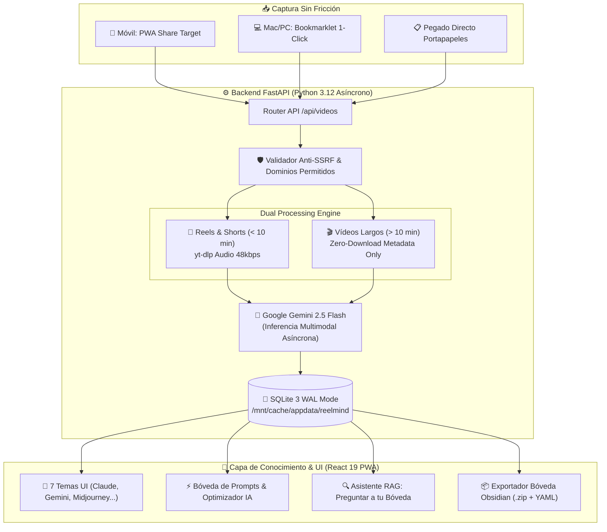

<div align="center">

# 🧠 ReelMind — AI Video Vault & Prompt Studio

**Tu segundo cerebro inteligente para capturar, analizar, optimizar y organizar trucos, prompts y herramientas desde TikTok, Instagram Reels y YouTube.**

[](https://fastapi.tiangolo.com)
[](https://react.dev)
[](https://www.typescriptlang.org)
[](https://tailwindcss.com)
[](https://deepmind.google/technologies/gemini/)
[](https://www.sqlite.org)
[](https://www.docker.com)
[](https://unraid.net)
[](https://web.dev/progressive-web-apps/)
[](LICENSE)

[🌐 Ver Demo en Producción](https://reels.wacko87.es) • [📖 Características](#-características-destacadas) • [🏗️ Arquitectura](#-arquitectura-del-sistema) • [🚀 Despliegue](#-guía-de-despliegue) • [🛡️ Seguridad](#-seguridad-y-blindaje-homelab)

</div>

---

## 💡 ¿Por qué ReelMind?

A todos nos pasa: vemos un reel genial en **TikTok**, **Instagram** o **YouTube** con una herramienta de IA revolucionaria, un mega-prompt para Midjourney o un truco de automatización... lo guardamos en la app nativa y **se pierde para siempre** en un pozo sin fondo.

**ReelMind** soluciona esto de raíz:
1. **Compartes el vídeo directamente desde tu móvil** o con **1 clic desde tu navegador de escritorio**.
2. **Gemini 2.5 Flash** procesa el contenido multimodalmente y extrae con precisión quirúrgica:
   - 🛠️ Herramientas y enlaces mencionados.
   - ⚡ Prompts exactos listos para copiar.
   - 📋 Pasos estructurados para replicar el truco.
   - ⏱️ Tiempo estimado para probar (`< 5 min`, `15-30 min`, `> 1 hora`).
3. Todo queda organizado en carpetas jerárquicas, searchable, consultable vía **RAG en lenguaje natural** y exportable en **1 clic a tu bóveda de Obsidian** en Markdown puro.

---

## 🏗️ Arquitectura del Sistema



---

## ✨ Características Destacadas

### 1. 📥 Ingestión Sin Fricción (Móvil & Escritorio)
- **PWA Share Target Nativa:** En tu iPhone o Android, dale a *Compartir* en TikTok o Instagram y selecciona **ReelMind**. El vídeo se guarda en segundo plano.
- **Bookmarklet 1-Click:** Arrastra el botón a tu barra de favoritos en Safari, Chrome o Arc para guardar mientras navegas en tu ordenador.
- **Detección Automática del Portapapeles:** Al abrir la app, con un toque en *"Pegar enlace"* la app detecta y procesa la URL.
- **Detección Amigable de Duplicados:** Si ya guardaste el vídeo, ReelMind te indica la carpeta exacta y fecha en que se archivó, ofreciéndote abrir su ficha al instante.

### 2. ⚡ Motor Dual: Reels Cortos vs Vídeos Largos
| Tipo | Duración | Estrategia de Descarga | Consumo de Tokens | Análisis IA |
|---|---|---|---|---|
| **📱 Reels / Shorts** | `< 10 min` | Descarga de audio optimizado (48kbps Opus) | ~1.500 - 3.000 tokens | Análisis multimodal completo (prompts, herramientas, pasos detallados). |
| **🎬 Tutoriales Largos** | `> 10 min` | **Cero descarga a disco** (enlace directo + metadatos) | ~500 tokens de texto | Resumen ejecutivo de alta síntesis para cursos y ponencias. |

### 3. 🎨 7 Temas de Diseño Profesional
ReelMind no es una app genérica; incluye un motor de diseño con 7 temas visuales calibrados al milímetro:
- **Claude:** Estética editorial cálida, terracota suave y tipografía Newsreader Serif.
- **Gemini:** Azul cósmico espacial, geometría limpia y estética cuántica moderna.
- **ChatGPT:** Carbón neutro minimalista, contraste equilibrado y verde esmeralda icónico.
- **OpenClaw:** Negro táctico de alto impacto con acentos carmesí neón.
- **Hermes Agent:** Consola de ciber-inteligencia, acentos cobre ardiente y tipografía monospace.
- **Vercel / v0:** Negro OLED absoluto, líneas hiperprecisas y azul cobalto.
- **Midjourney:** Púrpura noche espacial, atmósfera inmersiva y destellos lavanda.

### 4. 📦 Integración Profunda con Obsidian
- **Ficha Individual `.md`:** Descarga cualquier resumen con metadatos completos en **YAML Frontmatter**, enlaces originales, etiquetas, herramientas y bloques de código.
- **Bóveda Completa en `.zip`:** Exporta tu biblioteca completa respetando las subcarpetas jerárquicas e incluyendo un índice `Indice_Boveda.md` con enlaces internos `[[wikilinks]]`. Listo para descomprimir en tu bóveda de Obsidian (`/Antigravity/`).

### 5. 🪄 Bóveda de Prompts & Optimizador con IA
- **Cheatsheet Centralizado:** Filtra y copia todos los prompts extraídos de tus vídeos ordenados por modelo o herramienta.
- **Adaptador Multi-Modelo:** Modifica cualquier prompt al instante y adáptalo a la sintaxis y fortalezas técnicas de **Midjourney v6.1**, **Flux 1.1 Pro**, **DALL-E 3** o **Claude / ChatGPT**.

### 6. 🔍 "Preguntar a tu Bóveda" (Asistente RAG)
¿No recuerdas en qué vídeo explicaban cómo mantener la consistencia de un personaje o qué herramienta usaban para clonar voces?
Pregúntale a ReelMind en lenguaje natural. **Gemini 2.5 Flash** rastreará toda tu biblioteca y te responderá con una síntesis precisa, enlazando directamente las tarjetas de los vídeos fuente.

---

## 🛡️ Seguridad y Blindaje Homelab

ReelMind está diseñado bajo estándares estrictos para entornos auto-alojados expuestos a internet:

- **🔐 Protección por PIN (`AUTH_PIN`):** Bloqueo total de la interfaz y las APIs mediante token de sesión seguro.
- **🚫 Escudo Anti-SSRF:** Bloqueo estricto de accesos a redes privadas (`127.0.0.1`, `192.168.x.x`, `10.x.x.x`, `172.16.x.x`, `localhost`) y validación por lista blanca de dominios de vídeo legítimos.
- **⏱️ Mitigación DoS:** Límites estrictos de duración (10 min para audio) y tamaño de descarga (50MB) para no saturar memoria ni CPU.
- **🧼 Sanitización XSS:** Todos los enlaces externos e iframes están fuertemente filtrados y restringidos al protocolo `https://`.
- **💾 SQLite en Modo WAL:** Soporte de concurrencia elevada sin bloqueos de lectura/escritura (`journal_mode=WAL` y `busy_timeout=5000`).

---

## 🚀 Guía de Despliegue

### Opción 1: Desarrollo Local (Mac / Linux)

```bash
# 1. Clonar el repositorio
git clone https://github.com/Wacko87/reelmind.git
cd reelmind

# 2. Configurar variables de entorno
cp .env.example .env
# Edita .env y añade tu GEMINI_API_KEY y opcionalmente AUTH_PIN

# 3. Iniciar entorno completo (Frontend + Backend)
./dev.sh
```

La app estará disponible en:
- Frontend: `http://localhost:5173`
- Backend Swagger API: `http://localhost:8000/docs`

---

### Opción 2: Docker / Docker Compose

```yaml
version: '3.8'

services:
  reelmind:
    image: wacko87/reelmind:latest
    container_name: reelmind
    restart: unless-stopped
    ports:
      - "8000:8000"
    environment:
      - GEMINI_API_KEY=tu_api_key_de_gemini
      - AUTH_PIN=1234 # Opcional: deja vacío para acceso abierto
    volumes:
      - ./data:/app/data
      - ./downloads:/app/downloads
```

---

### Opción 3: Producción en Servidor Unraid (VLANs & Nginx Proxy Manager)

Para homelabs con segmentación de red por VLANs (ej. red `br0.11` en `192.168.11.237`):

1. **Configurar el contenedor en Unraid:**
   ```bash
   docker run -d \
     --name reelmind \
     --net br0.11 \
     --ip 192.168.11.237 \
     -v /mnt/cache/appdata/reelmind/data:/app/data \
     -v /mnt/cache/appdata/reelmind/downloads:/app/downloads \
     -e GEMINI_API_KEY="AIzaSy..." \
     -e AUTH_PIN="tu_pin" \
     --restart unless-stopped \
     reelmind:latest
   ```

2. **Nginx Proxy Manager:**
   - **Domain Names:** `reels.tudominio.es`, `reelmind.tudominio.es`
   - **Forward IP:** `192.168.11.237` | **Port:** `8000`
   - **SSL:** Let's Encrypt Wildcard, Force SSL, HTTP/2 Support.
   - **Websockets & Block Common Exploits:** Activados.

---

## 📱 Instalación PWA en tu Dispositivo Móvil

1. Abre `https://reels.wacko87.es` en **Safari** (iOS) o **Chrome** (Android).
2. Toca en el botón **Compartir** -> **"Añadir a pantalla de inicio"** (o "Instalar aplicación").
3. ¡Listo! Abre ReelMind como cualquier app nativa a pantalla completa y disfruta de la integración del sistema para compartir vídeos.

---

## 📡 API Endpoints (FastAPI)

| Método | Endpoint | Descripción |
|---|---|---|
| `GET` | `/api/videos` | Listado paginado y filtrado de vídeos y reels. |
| `POST` | `/api/videos` | Ingesta, descarga de audio y análisis con Gemini 2.5 Flash. |
| `GET` | `/api/videos/{id}` | Detalle completo de una ficha con pasos, prompts y herramientas. |
| `DELETE` | `/api/videos/{id}` | Eliminación de ficha y limpieza de audio temporal. |
| `GET` | `/api/folders` | Árbol de carpetas y subcarpetas con conteo de elementos. |
| `POST` | `/api/folders` | Creación de nuevas carpetas jerárquicas con iconos y colores. |
| `POST` | `/api/chat` | Consulta en lenguaje natural a la base de conocimiento (RAG). |
| `POST` | `/api/prompts/optimize` | Optimización de prompts para Midjourney, Flux, Claude y ChatGPT. |
| `GET` | `/api/export/obsidian/all` | Descarga de la bóveda completa en formato `.zip` estructurado. |

---

## 📄 Licencia

Distribuido bajo la Licencia **MIT**. Consulta el archivo [LICENSE](LICENSE) para más detalles.

---

<div align="center">
  <sub>Desarrollado con ☕, Python y React por <a href="https://github.com/Wacko87">Oscar (Wacko87)</a></sub>
</div>
